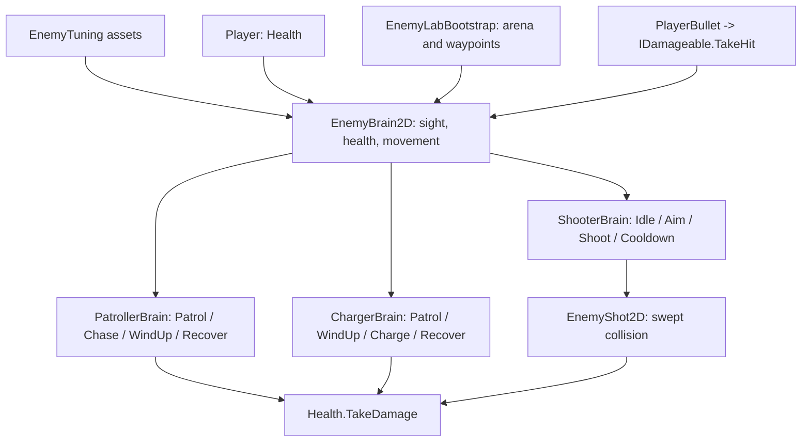

# Script map

The base shares mechanics, while each subclass owns its own transitions and attack behaviour. EnemyTuning provides persistent Inspector values. Scene bootstrap preserves the existing player and camera, instantiates all three types and switches to level1 after the encounter is cleared. State names and red warning markers are displayed above enemies for the video.
